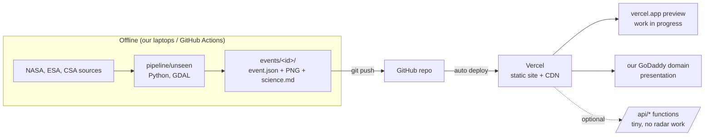

# 06 · Plan: architecture (serverless)

How the Flood Explorer runs with no server of our own. Overview: [05](05-Flood-plan.md).

## 1. The idea in one line

**Heavy work offline, light site online.** The Python pipeline turns GB of radar files into small event bundles (JSON +
PNG). The website is static files on **Vercel**, shown on our **GoDaddy** domain. No database, no server to keep alive.

## 2. Pieces

| Piece | Where | Runs on | Notes |
|---|---|---|---|
| Pipeline | `pipeline/unseen/` | laptops, GitHub Actions | fetch, detect, compare, validate, export bundle ([07](07-Plan-algorithm.md)) |
| Bundles ("database") | `events/` | git → Vercel CDN | JSON + PNG, the only thing the site reads ([08](08-Plan-data.md)) |
| Site | `index.html` + `site/` | browser | plain HTML/JS + Leaflet, no build step ([09](09-Plan-UI.md)) |
| Optional functions | `api/` | Vercel serverless | only small jobs: GDACS feed proxy (CORS) with cache. **No** NISAR processing. |
| Daily job (P2) | `.github/workflows/live.yml` | GitHub Actions (free) | once a day: GDACS floods → NISAR pass? → bundle → commit → Vercel redeploys |

## 3. Vercel setup (Roy)

1. The repo deploys from `main` on every push; Vercel serves the **repo root** as a static site, `index.html` is the entry page.
2. **`.vercelignore` is an allowlist.** For this plan add `!site/` and `!events/` (and nothing from `docs/`, `pipeline/`, `scripts/`, `data/`).
3. Other branches get preview URLs: try changes there before `main` (the demo).
4. Optional `vercel.json`: short cache for `events/**` so new bundles show up.
5. Repo rule: no Vercel project names, team names or dev URLs in the repo.

## 3b. Proposed folders in this repo (team to agree)

| Folder | What | Deployed |
|---|---|---|
| `index.html` | the app page | yes |
| `site/` | JS, CSS, vendor libraries (Leaflet + LICENSE) | yes |
| `events/` | bundles: `index.json`, `<id>/event.json`, PNG layers, `science.md`, `schema.json` | yes |
| `pipeline/` | Python package `unseen` (fetch, detect, compare, validate, export) | no |
| `scripts/` | `check_bundle.py`, validation scripts | no |

## 4. GoDaddy domain

1. Vercel → Project → Settings → Domains → add `ourdomain.com` and `www.ourdomain.com`.
2. GoDaddy → DNS: **A** record `@` → the IP Vercel shows (usually `76.76.21.21`); **CNAME** `www` → the target Vercel shows (`cname.vercel-dns.com`). Remove GoDaddy's default "parked" A record and forwarding.
3. Wait for Vercel to say "Valid configuration"; HTTPS certificate is automatic.
4. **Do it tonight:** DNS can take minutes to hours. Test on phone data (not office Wi-Fi) Saturday morning.
5. The submission "Final Project Link" is the domain; it goes in the README only when we submit (repo rule). Keep the vercel.app link privately as a backup.

## 5. Module boundaries (so 3 people work in parallel)

| Module | Input | Output | Can work without |
|---|---|---|---|
| Algorithm | radar files on a grid | GeoTIFFs + stats JSON | the site |
| Export | GeoTIFFs + stats | bundle (`event.json`, PNG) | the site |
| Site | bundles | pages | Python, NASA logins |
| Science text | results | markdown | code |

The contract between them is `events/schema.json`, checked by `scripts/check_bundle.py` before each push.

## 6. Drawbacks

- **No on-demand analysis online.** A visitor can't pick a new area and get NISAR results; only pre-processed events. Live floods appear at most once a day. Judges may ask "is it real-time?" → answer: daily, and the pipeline runs anywhere.
- **Vercel functions can't run the pipeline:** NISAR GCOV files are hundreds of MB, GDAL/rasterio are big, and the free tier has short time limits and small bundle sizes. Don't try.
- **Free (Hobby) plan is for non-commercial use** and has bandwidth / deploy limits. Fine for a hackathon; not for a product.
- **Repo size:** bundles in git grow with every re-run. Keep PNGs ≤ 2048 px, COGs out of git, total `events/` < 20 MB; overwrite, don't add versions.
- **Allowlist trap:** a new folder the site needs but missing from `.vercelignore` works locally and 404s online. Add the `!path` line in the same commit.
- **Public repo:** judges read it, so no dev URLs, secrets or personal details (repo rule).
- **GitHub Actions job needs Earthdata secrets** in the repo's Actions secrets (never in code). It also makes automatic commits, which can conflict with our pushes (`git pull` first, always).
- **Two providers to keep in sync** (Vercel + GoDaddy DNS). A DNS mistake shows the GoDaddy parked page on demo day. Keep the vercel.app link ready.
- **Static data is public.** Everything in `events/` can be downloaded by anyone. Only put open data and our results there (check licences in [08](08-Plan-data.md)).
