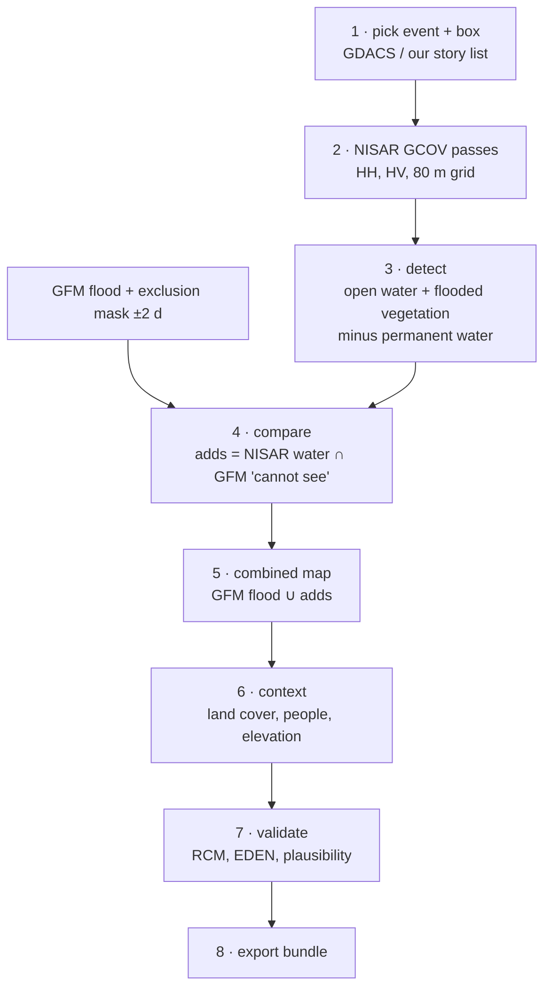

# 07 · Plan: algorithm

What the pipeline computes for each flood and how we check it. Results and their audit lines: `docs/10-Results.md` (created with the first number).
Overview: [05](05-Flood-plan.md). Owner: Noa (method, validation); story owners run it (Roy: Peace–Athabasca, RCM, RADARSAT-1 · Noa: Inner Niger · Shai: Tonle Sap).

## 1. Steps per event

## 2. Detector (`pipeline/unseen/detect.py`)

| Rule | What | Physics |
|---|---|---|
| Calibrate | thresholds (HH, HV dB) that best match optical water (OPERA DSWx-HLS) on clear days; leave-one-out score | water is dark at L-band; how dark depends on place (−20 dB lake, −15 dB ponds) |
| Open water | HH < t_HH and HV < t_HV (defaults −17 / −24 dB; never above −11 dB HH) | mirror-like surface reflects away from the radar |
| Flooded field | darkened ≥ 2.5 dB in HH and HV vs own baseline, ≥ 0.5 km², ends ≤ −12 dB HH, HH drop ≥ HV drop | water fills the field |
| Flooded vegetation | HH up ≥ 3 dB with HV steady (< 1.5 dB), next to water | **double bounce**: water + trunks |
| Permanent water | open on ≥ 90% of passes | removed: lake core, sea |

## 3. Gap vs official map (`pipeline/unseen/gfm.py`, `scripts/validation/gap_all.py`)

- GFM `ensemble_flood_extent` and `exclusion_mask` within ±2 days, nearest-neighbour onto the NISAR grid.
- **adds = NISAR_water ∩ GFM_excluded ∩ valid(both)**
- **area = pixels × 80 m × 80 m**; gain = adds / GFM flood.
- **Combined map** (new): GFM flood ∪ adds. This is "official map made more accurate with NISAR".
- Same for NASA DSWx-S1 (16 tiles at Tonle Sap): water neither official map shows.
- Split adds by WorldCover (tree / wetland / crop); people from WorldPop (P2).

## 4. Validation

| Check | How | Number to show |
|---|---|---|
| RCM same week (Peace–Athabasca) | RCM water = RL below midpoint of water/land medians; IoU with NISAR water | 79% agree, IoU 0.65 |
| RCM flooded vegetation | RR−RL above the 90th pct of dry vegetation where NISAR says flooded veg | ~4× chance |
| RCM polarimetry | m-χ: surface vs double vs volume | NISAR-only water is 84% surface scattering |
| EDEN gauges (Everglades) | depth > 5 cm = wet; precision / recall per pass | precision 0.95–1.00, recall ≤ 0.35 |
| Plausibility (Tonle Sap) | wet % of the added area per pass; elevation; land cover | 0% Jun → 100% Oct |
| Agreement with GFM where it sees | NISAR vs GFM flood | 85% |
| Long term (new) | RADARSAT-1 (1996–2013) and NISAR 2026, same grid, Otsu threshold in the valley/delta | change in wet km² |

## 5. To build this weekend

| Item | Owner | Priority |
|---|---|---|
| One **fixed date** per story (not best pass) | Noa + story owners | P0 |
| Combined-map layer | Noa | P1 |
| Export to bundle (`bundle.py`) | Shai | P0 |
| RCM agreement layer (agree / NISAR only / RCM only) | Roy | P1 |
| RADARSAT-1 on the NISAR grid at Peace–Athabasca | Roy | P1 |
| Time series stats per pass (for play) | Shai | P1 |
| Daily live job | Shai | P2 |

## 6. Drawbacks

- **Low recall in shallow marsh** (EDEN recall ≤ 0.35): water under sawgrass barely darkens L-band. All totals are **lower bounds**; say "at least".
- **Flooded forest has no ground truth yet.** The double-bounce rule is physics-based but unchecked against gauges in forest. Biggest scientific gap; the Tonle Sap claim rests on plausibility.
- **Thresholds are learned from optical.** In always-cloudy places there are few clear days → defaults, weaker.
- **Different dates and grids:** GFM ±2 days, 20 m → our 80 m (nearest neighbour). Small edges and fast floods blur.
- **Best-pass bias:** the 16-site table picks each site's best pass, which inflates it. Stories use fixed dates; label the table.
- **Percent on small bases is misleading** (Inner Niger +493%). Show km².
- **Wind and ice:** rough water is bright at C-band (RCM) and sometimes L-band; ice looks like land. Disagreement isn't always an error of one side.
- **RADARSAT-1 vs NISAR:** different band (C vs L), resolution, angle and geolocation. Long-term change must be large to be real; compare outlines, not small km² differences.
- **NISAR products are partly PROVISIONAL**; calibration may change.
- **Not new science:** L-band seeing flooded forest is known. Our claim is the measured gap in today's official maps, and that we checked it.
