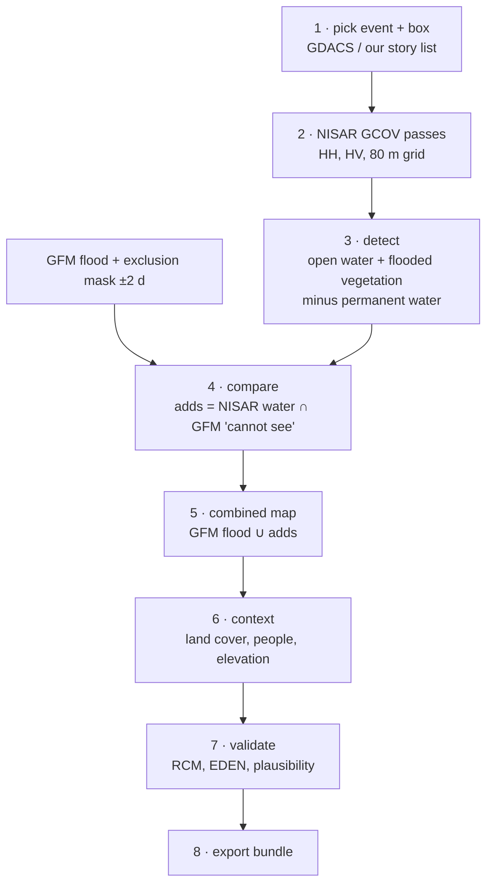
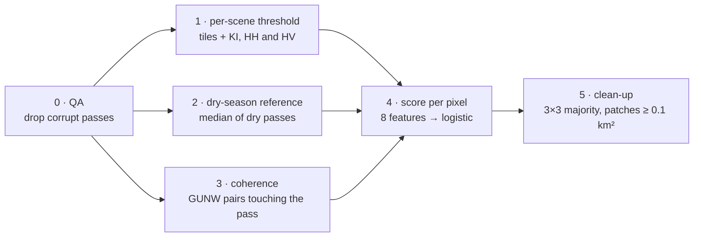

# 07 · Plan: algorithm

What the pipeline computes for each flood and how we check it. Results and their audit lines: `docs/10-Results.md` (created with the first number).
Overview: [05](05-Flood-plan.md). Owner: Noa (method, validation); story owners run it (Roy: Peace–Athabasca, RCM, RADARSAT-1 · Noa: Inner Niger · Shai: Tonle Sap).

## 1. Steps per event

## 2. Detector (`pipeline/unseen/detect.py`)

| Rule | What | Physics |
|---|---|---|
| Calibrate | thresholds (HH, HV dB) that best match optical water (OPERA DSWx-HLS) on clear days; leave-one-out score | water is dark at L-band; how dark depends on place (−20 dB lake, −15 dB ponds) |
| Open water | HH < t_HH and HV < t_HV (defaults −17 / −24 dB; never above −11 dB HH) | mirror-like surface reflects away from the radar |
| Flooded field | darkened ≥ 2.5 dB in HH and HV vs own baseline, ≥ 0.5 km², ends ≤ −12 dB HH, HH drop ≥ HV drop | water fills the field |
| Flooded vegetation | HH up ≥ 3 dB with HV steady (< 1.5 dB), next to water | **double bounce**: water + trunks |
| Permanent water | open on ≥ 90% of passes | removed: lake core, sea |

## 2b. Fused detector (v3): paper threshold + our change rules + NISAR coherence

Tested on the Inner Niger Delta (box 14.60–15.20° N, 4.60–4.00° W), NISAR tracks 145 A and 138 D, Jun–Nov 2026.
It combines the automatic flood method of **Martinis et al. (2015)** (DLR's TerraSAR-X flood service, an ancestor of DLR's
part of GFM) with our temporal rules and two L-band signals: HV and 12-day **coherence** (GUNW).

**0 · Quality check.** Drop a pass if its scene median HH is > 3 dB from the stack median. (Inner Niger, track 145, 6 Jul:
+8.2 dB vs −14 dB; it had broken the old detector's baseline for every date.)

**1 · Per-scene threshold (Martinis).** Split the pass into 40 × 40 px tiles (3.2 km). In each tile, find the
Kittler–Illingworth (KI) minimum-error threshold *k* that splits the dB histogram into two Gaussians:

$$J(k)=1+2\,[P_1\ln\sigma_1+P_2\ln\sigma_2]-2\,[P_1\ln P_1+P_2\ln P_2],\qquad k^*=\arg\min_k J(k)$$

Keep tiles that are clearly two-class: Ashman's $D=\sqrt2\,|\mu_1-\mu_2|/\sqrt{\sigma_1^2+\sigma_2^2}>2$, each class ≥ 10 %,
dark class < −14 dB. Scene threshold $t$ = median $k^*$ of kept tiles (≥ 5 tiles; else KI on the whole scene).
Done for HH ($t_{HH}$) and HV ($t_{HV}$). Inner Niger flood season: $t_{HH}$ ≈ −15 to −16 dB.

**2 · Dry reference.** Per pixel, median HH and HV of the dry-season passes (before the flood rises, here Jun–Jul):
$HH_{dry}$, $HV_{dry}$.

**3 · Coherence.** Mean GUNW coherence $\gamma$ of the 12-day pairs that include the pass (pairs with scene median < 0.2 are
dropped as corrupt). Water decorrelates within 12 days ($\gamma$ ≈ 0.1); dry bare soil stays coherent ($\gamma$ ≈ 0.5).

**4 · Score.** Eight features per pixel, standardised ($z_i=(x_i-\bar x_i)/s_i$), combined by logistic regression:

$$p(\text{water})=\sigma\Big(b+\sum_i w_i z_i\Big),\qquad \sigma(u)=\frac{1}{1+e^{-u}},\qquad \text{water if } p\ge 0.30$$

| Feature $x_i$ | Physics | Weight $w_i$ |
|---|---|---|
| $\gamma$ coherence | water scrambles phase in 12 days | **−1.40** |
| $HV-t_{HV}$ | water is dark in cross-pol | **−1.10** |
| $HH-HV$ | specular water: small HH/HV gap | −0.58 |
| $HH-HH_{dry}$ | flood water got 2–3 dB darker than its dry self | −0.41 |
| $HH-t_{HH}$ | water is dark in co-pol (paper's rule) | −0.23 |
| $HV-HV_{dry}$, $HH_{dry}-t_{HH}$, height above lowest ground within 2 km | weak here | 0.08 / 0.07 / 0.00 |

Intercept $b$ = −3.03. Fitted on track 145 (flood-season + dry passes, labels = OPERA DSWx-HLS water on clear days);
the cut 0.30 was chosen on track 145 only.

**5 · Clean-up.** 3 × 3 majority filter; drop patches < 0.1 km². Area = pixels × 80 m × 80 m.

**Newest pass:** it has no coherence yet (its 12-day pair comes with the next pass), so use the same model without $\gamma$
(F1 0.68 on the test track).

### Results (truth: OPERA DSWx-HLS, clear days within ±3 days)

Test = **track 138**, never used for fitting. F1 = 2·precision·recall / (precision + recall).

| Pass (track 138) | Optical water km² | Old detector F1 | Paper method F1 | **Fused F1** |
|---|---|---|---|---|
| 3 Sep | 421 | 0.00 | 0.44 | **0.56** |
| 15 Sep | 470 | 0.00 | 0.60 | **0.71** |
| 27 Sep | 1,130 | 0.02 | 0.69 | **0.77** |
| 9 Oct | 659 | 0.01 | 0.63 | **0.68** |
| 21 Oct | 1,435 | 0.03 | 0.70 | **0.77** |
| **Mean** | | **0.01** | **0.61** | **0.70** |

- Dry season (optical 9–16 km² of water): false water 1,500–2,300 km² (paper method) → **270–340 km²** (fused).
- Track 145 (fit track): mean F1 0.71.
- Why it works: brightness alone cannot separate water from dark, dry Sahel soil at L-band (−17 vs −18 dB HH).
  Coherence and HV can. Both are NISAR L-band products.

### v3 vs the handbook classifier (v4) and the paper method, Inner Niger

v4 = NISAR Science Users' Handbook §6.3–6.4 classifier: classes NI / OW / IV / NC from change against the pixel's own
recent dry state, confidence P = Φ(m/σ) ≥ 0.8, mask without cropland, built-up, bare land and slopes > 5°.
Same passes, same truth (OPERA DSWx-HLS, clear days), same quality check. Mean F1 over flood-season passes that have coherence.

| Method | Track 145 (v3 fitted here) | **Track 138 (held out)** | Dry-season false water (km², Jun–Jul) | Precision / recall style |
|---|---|---|---|---|
| Old detector (§2) | 0.21 | 0.01 | 2–1,738 | breaks on one bad pass; misses most water on track 138 |
| Paper method (Martinis) | 0.62 | 0.61 | 525–2,280 | over-detects |
| v4 handbook, θ_ow −17 dB | 0.57 (0.61 in its mask) | 0.57 (0.61 in its mask) | 231–400 | high precision, low recall |
| v4 handbook, θ_ow −16 dB | 0.60 (0.64) | 0.60 (0.64) | 465–800 | |
| **v3 fused** | **0.71** | **0.70** | 6–537 | balanced (P ≈ 0.6–0.7, R ≈ 0.8–0.9) |

- Newest pass (no coherence yet): v4 0.56–0.64; v3 without coherence 0.68–0.73. v3 still ahead.
- v4 keeps 84 % of this box (it masks cropland 12 %, bare 3 %); it still lets in 230–400 km² of dry dark ground.
- **Use:** v3 for water extent. Keep v4's **IV class** (flooded vegetation, double bounce) and its confidence layer:
  optical cannot see water under vegetation, so this test cannot score IV. Next: v3 ∪ v4-IV, scored at a site with
  ground truth under vegetation (Everglades EDEN).

### Limits of v3
- One site so far (Inner Niger, two tracks). Must be re-tested elsewhere (Everglades with EDEN gauges, Mekong) before it is a general claim.
- Labels are optical: optical misses water under vegetation, so some "false" NISAR water may be real flooded grass.
- 270–340 km² of false water remains in the dry season (wet soil after rain?).
- Needs a dry-season reference and ≥ 1 GUNW pair per pass.
- Open water focus; flooded vegetation still relies on the double-bounce rule in §2.

## 3. Gap vs official map (`pipeline/unseen/gfm.py`, `scripts/validation/gap_all.py`)

- GFM `ensemble_flood_extent` and `exclusion_mask` within ±2 days, nearest-neighbour onto the NISAR grid.
- **adds = NISAR_water ∩ GFM_excluded ∩ valid(both)**
- **area = pixels × 80 m × 80 m**; gain = adds / GFM flood.
- **Combined map** (new): GFM flood ∪ adds. This is "official map made more accurate with NISAR".
- Same for NASA DSWx-S1 (16 tiles at Tonle Sap): water neither official map shows.
- Split adds by WorldCover (tree / wetland / crop); people from WorldPop (P2).

## 4. Validation

| Check | How | Number to show |
|---|---|---|
| RCM same week (Peace–Athabasca) | RCM water = RL below midpoint of water/land medians; IoU with NISAR water | 79% agree, IoU 0.65 |
| RCM flooded vegetation | RR−RL above the 90th pct of dry vegetation where NISAR says flooded veg | ~4× chance |
| RCM polarimetry | m-χ: surface vs double vs volume | NISAR-only water is 84% surface scattering |
| EDEN gauges (Everglades) | depth > 5 cm = wet; precision / recall per pass | precision 0.95–1.00, recall ≤ 0.35 |
| Plausibility (Tonle Sap) | wet % of the added area per pass; elevation; land cover | 0% Jun → 100% Oct |
| Agreement with GFM where it sees | NISAR vs GFM flood | 85% |
| Long term (new) | RADARSAT-1 (1996–2013) and NISAR 2026, same grid, Otsu threshold in the valley/delta | change in wet km² |

## 5. To build this weekend

| Item | Owner | Priority |
|---|---|---|
| One **fixed date** per story (not best pass) | Noa + story owners | P0 |
| Combined-map layer | Noa | P1 |
| ~~Fused detector v3 into the pipeline (§2b) + QA check~~ done: `pipeline/unseen/fused.py`, default in `unseen site/build` | Noa | P0 |
| Re-run gap numbers for all sites with v3 (blocked: GFM catalogue down, 15 Nov night) | Noa | P0 |
| Test v3 on a second site (Everglades EDEN or Mekong) | Noa | P1 |
| Export to bundle (`bundle.py`) | Shai | P0 |
| RCM agreement layer (agree / NISAR only / RCM only) | Roy | P1 |
| RADARSAT-1 on the NISAR grid at Peace–Athabasca | Roy | P1 |
| Time series stats per pass (for play) | Shai | P1 |
| Daily live job | Shai | P2 |

## 6. Drawbacks

- **Low recall in shallow marsh** (EDEN recall ≤ 0.35): water under sawgrass barely darkens L-band. All totals are **lower bounds**; say "at least".
- **Flooded forest has no ground truth yet.** The double-bounce rule is physics-based but unchecked against gauges in forest. Biggest scientific gap; the Tonle Sap claim rests on plausibility.
- **Thresholds are learned from optical.** In always-cloudy places there are few clear days → defaults, weaker.
- **Different dates and grids:** GFM ±2 days, 20 m → our 80 m (nearest neighbour). Small edges and fast floods blur.
- **Best-pass bias:** the 16-site table picks each site's best pass, which inflates it. Stories use fixed dates; label the table.
- **Percent on small bases is misleading.** Show km².
- **Old Inner Niger numbers are invalid:** a corrupt pass (6 Jul, track 145) broke the old detector's baseline. Re-run with the QA check (§2b) before quoting any Inner Niger number.
- **Wind and ice:** rough water is bright at C-band (RCM) and sometimes L-band; ice looks like land. Disagreement isn't always an error of one side.
- **RADARSAT-1 vs NISAR:** different band (C vs L), resolution, angle and geolocation. Long-term change must be large to be real; compare outlines, not small km² differences.
- **NISAR products are partly PROVISIONAL**; calibration may change.
- **Not new science:** L-band seeing flooded forest is known. Our claim is the measured gap in today's official maps, and that we checked it.
