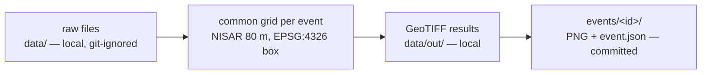

# 08 · Plan: data

Which data we use, how it reaches the site, and the bundle contract everyone codes against.
Overview: [05](05-Flood-plan.md). Full source list: [04](04-Sources-and-tools.md); credits: `ACKNOWLEDGMENTS.md`.

## 1. Sources

| Data | Role | Band / res | Access | In code |
|---|---|---|---|---|
| **NISAR L2 GCOV** | main measurement | L-band, HH/HV, 80 m | ASF DAAC, Earthdata login | `gcov.py`, `nisar.py` |
| NISAR L2 GUNW | coherence (optional) | L-band | ASF DAAC | `gunw.py` |
| **Copernicus GFM** | official flood + "cannot see" mask | C-band (Sentinel-1), 20 m | EODC STAC, open | `gfm.py` |
| **NASA OPERA DSWx-S1** | second official map | C-band, 30 m | PO.DAAC, Earthdata | `flood_nasa.py` |
| OPERA DSWx-HLS | optical water, to calibrate | optical, 30 m | PO.DAAC | `optical.py` |
| HLS true colour | the photo layer | optical | NASA GIBS tiles (browser) | `site/` |
| **CSA RCM** ARD | validation, now | C-band compact-pol, 20 m | AWS `rcm-ceos-ard` | `rcm.py` |
| **CSA RADARSAT-1** | then (1996–2013) | C-band | AWS `radarsat-r1-l1-cog` | to build (Roy) |
| USGS EDEN | ground truth | gauges → 400 m | USGS | `scripts/validation/eden_*.py` |
| WorldCover, WorldPop, Copernicus DEM | context | 10–90 m | open | `landcover.py`, `population.py`, `dem.py` |
| GDACS | event list | – | open RSS/API | `events.py` |
| ALOS PALSAR (optional) | L-band then (2006–11) | L-band | ASF | P2 |

## 2. Flow and storage



- Raw HDF5 and GeoTIFFs never go to git (team rule). Only the small bundles do.
- One grid per event (the NISAR 80 m grid). Every other source is resampled onto it, so layers line up.

## 3. Bundle contract v1 (freeze tonight)

> v2 draft (place → flood → history folders, event window, metadata): [12](12-Event-folders.md).

```
events/
  index.json            # all events: id, title, place, date, bbox, kind (world|story|site|live), headline numbers
  schema.json           # JSON Schema for event.json
  methods.md            # shared science text
  <id>/
    event.json
    science.md
    layers/<layer>_<YYYY-MM-DD>.png   # RGBA, EPSG:4326 bounds, ≤ 2048 px
```

`event.json` (short form):

```json
{
  "id": "peace-athabasca-2026",
  "title": "Peace–Athabasca Delta, Canada",
  "kind": "story",
  "bbox": [-112.0, 58.3, -110.8, 59.0],
  "headline": {
    "date": "2026-10-10",
    "sentence": "Canada's RCM radar confirms NISAR's water, the same week.",
    "numbers": [
      {"label": "RCM agrees", "value": 79, "unit": "%"},
      {"label": "NISAR water", "value": 0, "unit": "km²"},
      {"label": "since 1998", "value": 0, "unit": "km²"}
    ],
    "badge": {"text": "Independent radar check", "ref": "validation.rcm"}
  },
  "timeline": [
    {"date": "2026-10-10", "stats": {"nisar_km2": 0, "rcm_km2": 0, "iou": 0.65},
     "layers": ["photo", "nisar_water", "rcm_water", "agreement"]}
  ],
  "layers": {
    "rcm_water": {"group": "validation", "sensor": "RCM", "legend": "#3aa0ff",
                   "files": {"2026-10-13": "layers/rcm_water_2026-10-13.png"},
                   "bounds": [[58.3, -112.0], [59.0, -110.8]], "default": false}
  },
  "validation": {"rcm": {"metric": "agreement", "value": 0.79, "n_dates": 4}},
  "sources": [{"name": "RCM CEOS-ARD", "url": "https://registry.opendata.aws/", "credit": "RADARSAT Constellation Mission, © Government of Canada (CSA)"}]
}
```

(Values 0 and the bbox are placeholders until the Peace–Athabasca bundle exists.)

Rules:
- Layer groups: `base`, `radar`, `official`, `result`, `validation`, `context`. Layer ids from a fixed list ([09](09-Plan-UI.md)).
- Every number in the UI comes from `event.json`, written by the pipeline. No numbers typed in HTML.
- Each number has an audit line (script, input, date) in `docs/10-Results.md`.
- `scripts/check_bundle.py` validates schema, file existence, PNG size, total size. Run before every push.

## 4. Drawbacks

- **PNG layers are pictures, not data.** No pixel values, no reprojection in the browser, fixed resolution. A COG / tile service would be better but needs a server or a bigger storage plan.
- **Repo and Vercel size limits.** 3–5 stories × ~10 passes × 6 layers adds up fast. Budget: ≤ 20 MB total; fewer passes in play if needed.
- **Licences differ per source.** RCM / RADARSAT-1 credit lines are still to verify against the CSA licence; GFM, WorldPop, WorldCover each have their own. All must be in `ACKNOWLEDGMENTS.md` before the site is public.
- **Mixed dates.** "Same week" pairs are ±2–3 days apart; floods move. Each layer shows its own date.
- **Earthdata login needed** for NISAR and DSWx downloads; only people with `.netrc` can re-run the pipeline. The site needs no login.
- **RADARSAT-1 coverage is uneven** and its geolocation needs fixing. Peace–Athabasca is well covered: 619 scenes 1996–2013 ([10](10-Results.md)).
- **GFM gaps:** some GFM items lack the exclusion mask (6 sites failed one pass); 3 sites had no overlap with NISAR.
- **Schema freeze is a bottleneck.** Changing it after tonight breaks other people's work; add optional fields only.
