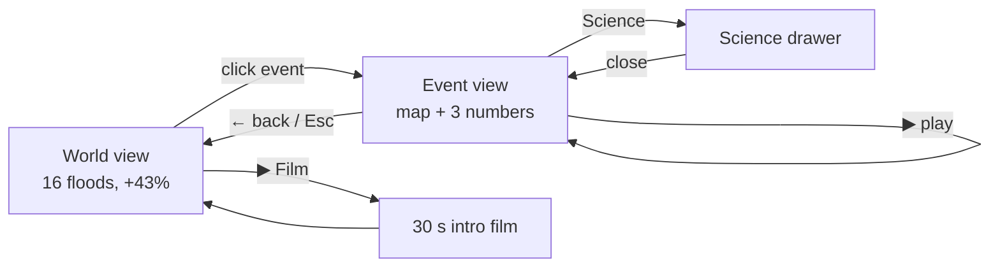

# 09 · Plan: UI design

Screens of the Flood Explorer. Overview: [05](05-Flood-plan.md). Rule: keep the user on
the map; short text; detail only on request.

## 1. Flow



One page, one map. Entering an event = fly to its box and load its layers. URL hash keeps state (`#e=<id>&t=<date>`), so
links and the browser back button work.

## 2. World view (first screen)

```
┌──────────────────────────────────────────────────────────────┐
│ Flood Explorer · official maps leave a blank   [About] [▶ Film]│
├───────────────┬──────────────────────────────────────────────┤
│ +43%          │                                              │
│ more flood    │   world map, one dot per flood               │
│ than official │   dot size = km² NISAR adds                  │
│ maps show     │                                              │
│ (16 floods)   │                                              │
│ ───────────── │                                              │
│ STORIES       │                                              │
│ 1 Peace–Ath.  │                                              │
│ 2 Inner Niger │                                              │
│ 3 Tonle Sap   │                                              │
│ ALL FLOODS    │                                              │
│ LIVE (GDACS)  │                                              │
└───────────────┴──────────────────────────────────────────────┘
```

## 3. Event view: first look

```
┌──────────────────────────────────────────────────────────────┐
│ ← All floods   Inner Niger Delta, Mali · 16 Sep 2026         │
├──────────────────────────────────────┬───────────────────────┤
│                                      │ 51 km²   official map │
│   photo (often cloudy) as base       │ +253 km² NISAR adds   │
│   blue   = official flood (GFM)      │ 304 km²  total        │
│   grey   = official "cannot see"     │                       │
│   orange = NISAR finds water there   │ "The official map is  │
│                                      │ blank over the wet-   │
│                                      │ lands. NISAR sees the │
│                                      │ water."               │
│                                      │ ✓ Method checked (RCM)│
│                                      │ [Layers] [Science]    │
├──────────────────────────────────────┴───────────────────────┤
│ ▶  Jul ─ ● ─ ● ─ ● ─ ●(16 Sep) ─ ● ─ ● Oct     before | after  │
└──────────────────────────────────────────────────────────────┘
```

Rule: **3 numbers, 2 sentences, 3 colours, 1 badge.** Everything else is one click away.

## 4. Layers panel (closed by default)

| Group | Layer ids | Default |
|---|---|---|
| base | `basemap`, `photo` (HLS true colour) | photo on |
| radar | `nisar_rgb` (HH/HV), `rcm_rgb`, `rs1_rgb` (RADARSAT-1) | off |
| official | `gfm_flood`, `gfm_excluded`, `dswx_s1`, `gfm_refwater` | flood + excluded on |
| result | `nisar_water`, `nisar_floodveg`, `nisar_adds`, `combined` | adds on |
| validation | `rcm_water`, `agreement` | off |
| context | `landcover`, `people` | off |

Each layer: on/off, opacity, legend chip, sensor + date, source link.

## 5. Time

- **Play:** ticks = NISAR passes; each tick swaps layers and the side numbers. ~1.2 s per step; zoom kept; missing passes shown as gaps.
- **Then / now:** swipe bar (left RADARSAT-1 1990s–2000s, right NISAR 2026) for the long-term story.

## 6. Science drawer (from the right, tabs)

Method (diagram + rules + equations) · Data (each product, band, date, link) · Validation (tables, charts) · Limits ·
Sources & credits. Text from `methods.md` + `science.md` (markdown, written by Roy and Shai).

## 7. Tech

- **Leaflet** (in `site/vendor/leaflet`, with its LICENSE), `L.imageOverlay` for PNG layers, a small swipe control, no build step.
- Basemap: light open tiles + HLS photo from NASA GIBS.
- Must work on a laptop projector and on a phone (judges open the link on phones).

## 8. Drawbacks

- **Leaflet is 2D and raster-only;** no smooth 3D globe, and many large PNG overlays can stutter on phones. Preload the next pass, keep PNGs small.
- **Image overlays don't reproject** — fine in Web Mercator for small boxes, distorted for very large or high-latitude boxes (Peace–Athabasca at 58° N is OK; a continent is not).
- **Legends must stay honest:** grey "cannot see" is GFM's own mask; orange is our claim. Mixing colours with overlap can confuse; use no overlap colour.
- **HLS photo is not same-day** for every pass; show its date or it misleads.
- **Science drawer can become a wall of text.** Keep each tab one screen; link to docs for more.
- **Accessibility:** blue / orange is colour-blind friendly; grey on a light basemap is weak, so add a hatch pattern.
- **Static site = no search box for new places.** Only listed events.
